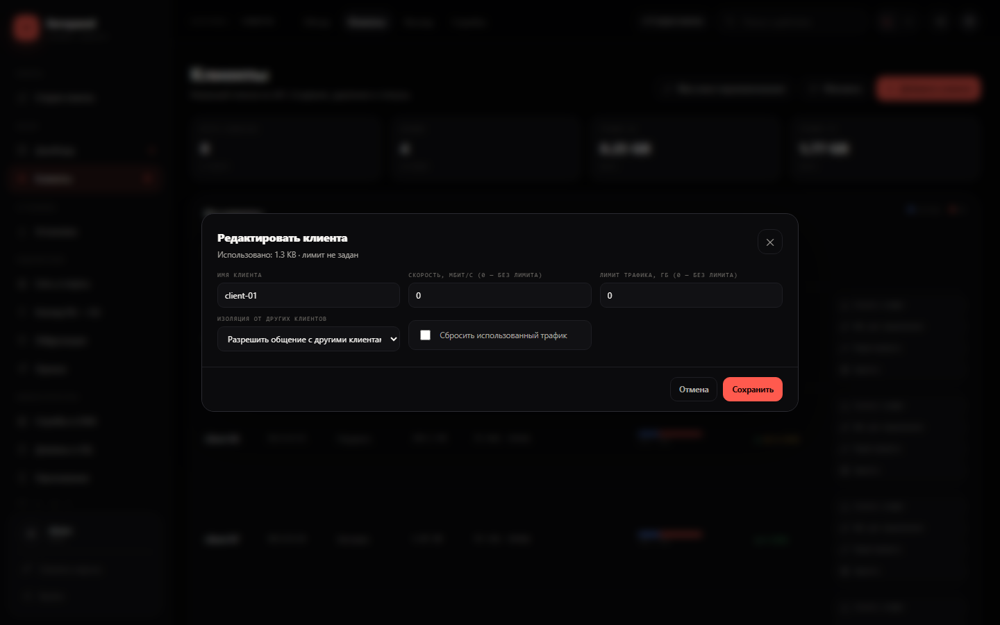

# Carbon-интерфейс

Версия панели: **3.2.121**.

Carbon — основной интерфейс панели. Он открывается по корню `/`. Старая панель доступна по `/old/` и кнопкой **«Старая панель»** в шапке.

## Вход и переключение

- **Carbon:** `/`
- **Старая панель:** `/old/`
- В старой панели переход — **«Обновлённая панель»** в меню и в шапке.
- В Carbon переход — **«Старая панель»** в шапке и в разделе **«Визуализация»**. В боковом меню этого пункта нет.

## Визуализация

Раздел **«Система → Визуализация»**:

- шаблоны оформления: **Carbon**, **Старая панель**, **Свои цвета**;
- отдельные цвета фона, панелей, полей, границ и текста для тёмной и светлой темы;
- два основных акцента закреплены: тёмная `#FF5A4E`, светлая `#D94436`;
- кнопка **«Сбросить к Carbon»**;
- настройки хранятся в браузере (`localStorage`), на сервер не отправляются.

## Скачивание файлов

Все файлы в Carbon скачиваются через общий индикатор: имя, процент, размер, скорость и кнопка отмены. Пока сервер готовит файл (первый запрос RustDesk или создание бэкапа), показывается полоса неопределённого прогресса и счётчик времени.

Покрыты: клиенты RustDesk, конфиги AWG, инструкции клиентов, APK, экспорт обфускации, архивы бэкапа, пакетное скачивание конфигов.

## Что нового

- **Carbon — основной интерфейс.** `/` открывает Carbon, `/old/` — старую панель.
- **Визуализация.** Шаблоны, свои цвета и закреплённые акценты.
- **Полоса загрузки файлов.** Прогресс, скорость и отмена для всех скачиваний.
- **Keenetic.** Парк до 60 роутеров, WireGuard-туннели, health-check, DNS-списки и правила, раздельный импорт/экспорт.
- **Каскад RU → EU.** Резервные копии, ручное и автоматическое переключение, проверка handshake и трафика, `MTU = 1200` между серверами.
- **MTProto.** Домен в `tg://`-ссылках, живой прогресс установки.
- **Безопасность.** Kill switch каскада, блокировка IPv6, HSTS, `no-store` для API.

## Скриншоты

Скриншоты сняты на демо-данных: имена клиентов, IP и логин заменены, адрес `203.0.113.10` — документационный.

### Живой дашборд

KPI, скорость, CPU, RAM, uptime, график, распределение и таблица клиентов обновляются автоматически. В шапке — отметка «обновлено ЧЧ:ММ:СС», справа вверху — **«Настройки»**.

### Клиенты и сортировка

Сортировка по имени, IP, состоянию, трафику, скорости, рукопожатию, каскаду/RU и связи. Слева — порядковый номер конфига, колонка **«Каскад / RU»** сортирует по доле RU-трафика. В колонке **«Скорость»** — ↓ Rx / ↑ Tx, рядом фильтр «от, КБ/с».

### Изоляция клиента

В карточке клиента: «как на сервере», «изолировать», «разрешить общение». Правила применяются в отдельной цепочке `SERVPANEL_ISOLATION`.

### Часовой пояс

Пояс выбирается в настройках дашборда или кнопкой рядом с графиком. Сохраняется на сервере и применяется к времени на графиках.

### Живой лог обновления

Прогресс, шаг, статус, журнал и ошибка обновляются каждую секунду. Во время перезапуска показывается состояние **«перезапуск»**.

## Что это

`public/carbon/` — отдельный SPA. Он использует реальный API панели:

- вход/выход и сессия — `/api/login`, `/api/logout`;
- клиенты — `/api/clients`, `/api/create`, `/api/delete`;
- лимиты и изоляция — `/api/clients/:name/limits`, `/api/clients/:name/isolation`;
- модули — `/api/modules`, `/api/install/module`;
- службы — `/api/services`, `/api/services/restart`;
- сеть — `/api/interfaces`, `/api/ufw`, `/api/awg/config`;
- Keenetic — `/api/keenetic/*`;
- каскад — `/api/cascade/*`;
- обфускация — `/api/obf/*`;
- прокси — `/api/proxy/*`;
- SSL — `/api/ssl/*`;
- приложение — `/api/app/*`;
- RustDesk — `/api/rustdesk/*`;
- защита — `/api/security/status`, `/api/tools/rudrop`;
- диагностика — `/api/diag/*`;
- обновление — `/api/update/*`;
- настройки панели — `/api/panel/settings`;
- администрирование — `/api/users`, `/api/audit`, `/api/backup/*`, `/api/notify/*`.

## Проверка перед обновлением

1. Сделайте бэкап панели.
2. Откройте `/` на тестовом сервере.
3. Войдите тем же логином.
4. Проверьте чтение: дашборд, клиенты, Keenetic, модули, службы, защита.
5. Проверьте безопасные действия: обновление, диагностика, копирование.
6. Проверьте изменения на тестовом сервере: создание клиента, UFW, GeoIP, DNS-правило Keenetic.
7. Только после этого обновляйте рабочую панель.

Откат — ссылка **«Старая панель»** или `/old/`.

## Файлы

- `public/carbon/index.html` — разметка SPA.
- `public/carbon/styles.css` — стили Carbon.
- `public/carbon/app.js` — интерфейс и компоненты.
- `public/carbon/carbon-api.js` — привязка к API и реальные данные.
- `public/carbon/actions.js` — действия, обновление, клиенты, AdGuard, WARP.
- `public/carbon/keenetic.js` — интерфейс Keenetic.
- `docs/screenshots/` — скриншоты для README, CARBON и DEMO.

## Обратная связь

Если что-то работает не так:

1. Проверьте, что старая панель по `/old/` работает.
2. Сделайте бэкап.
3. Опишите шаги, версию и текст ошибки.
4. Приложите скриншот без реальных IP, доменов и логинов.
