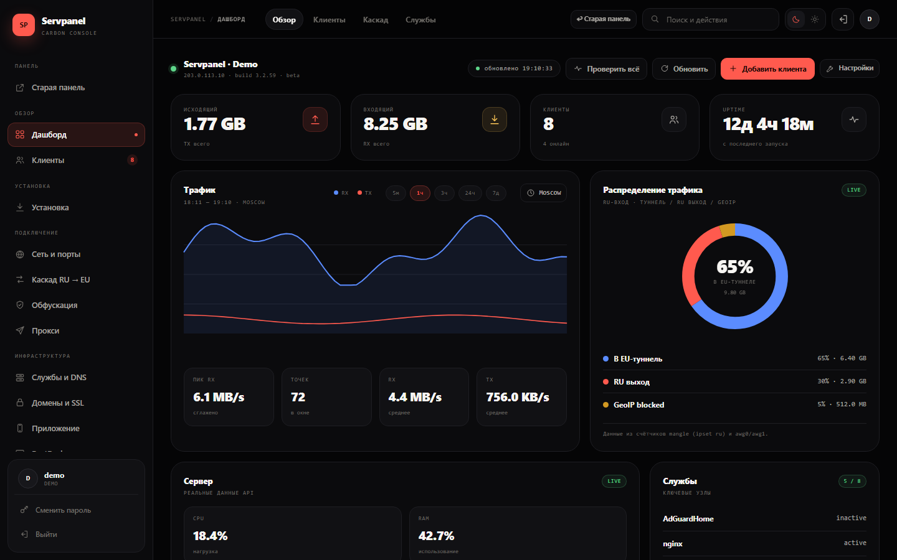
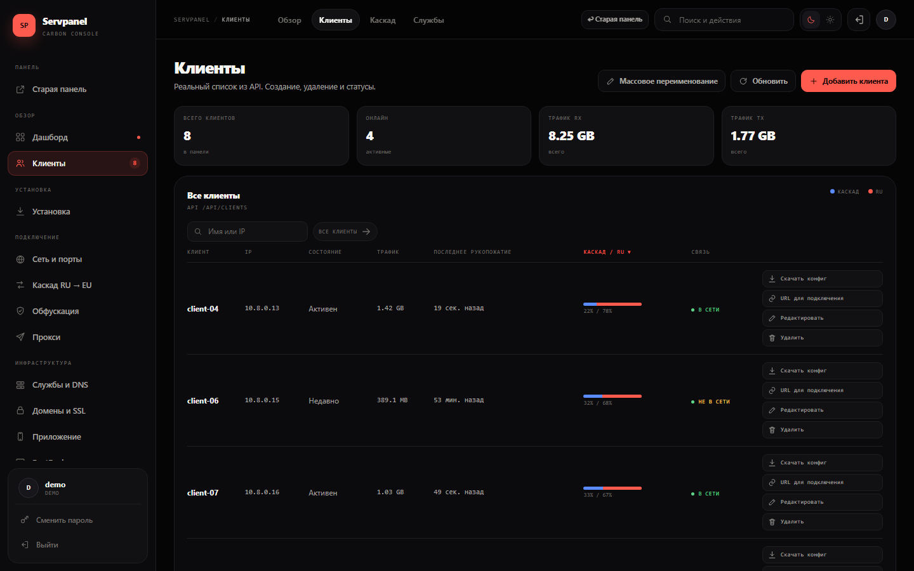
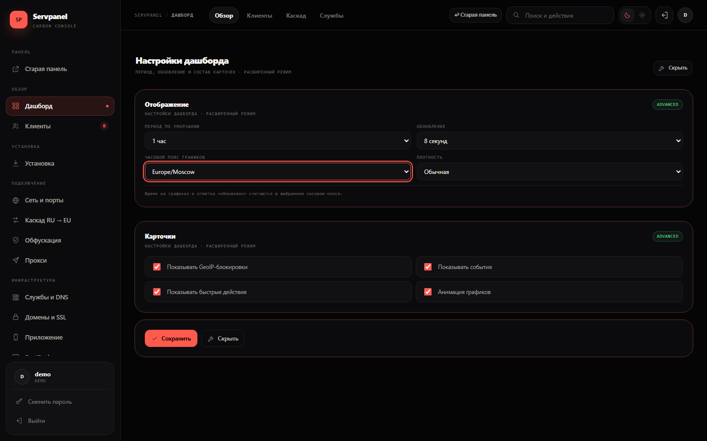
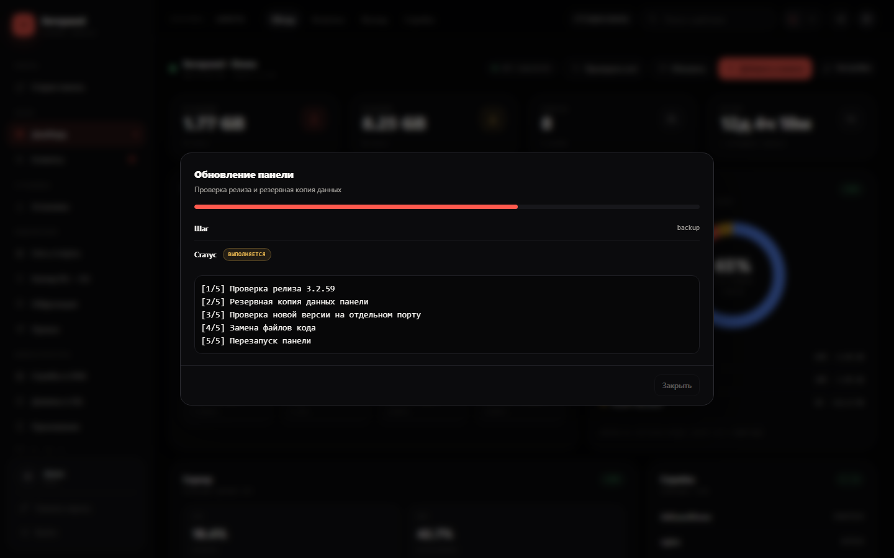

# Carbon-интерфейс

Версия панели: **3.2.59**.

> ⚠️ **Статус: бета.** Carbon-интерфейс активно развивается. Перед обновлением рабочего сервера сделайте бэкап и проверьте новую версию на тестовом стенде. Старая панель остаётся доступной по `/` и может использоваться как запасной вариант.

Новый интерфейс доступен по адресу:

```
/carbon/
```

Старая панель остаётся по `/`.

## Скриншоты

Скриншоты сняты на демо-данных: имена клиентов, IP и логин заменены, адрес `203.0.113.10` — документационный.

### Живой дашборд



KPI, скорость, CPU, RAM, uptime, график, распределение и таблица клиентов обновляются автоматически. В шапке — отметка «обновлено ЧЧ:ММ:СС», справа вверху — **«Настройки»**.

### Клиенты и сортировка



Сортировка по имени, IP, состоянию, трафику, рукопожатию, каскаду/RU и связи. Колонка **«Каскад / RU»** сортирует по доле RU-трафика.

### Часовой пояс



Пояс выбирается в настройках дашборда или кнопкой рядом с графиком. Сохраняется на сервере и применяется к времени на графиках.

### Живой лог обновления



Прогресс, шаг, статус, журнал и ошибка обновляются каждую секунду. Во время перезапуска показывается состояние **«перезапуск»**.

## Что нового в Carbon

- **Живой дашборд.** Обновление KPI, системных метрик, графика и таблицы без перезагрузки страницы.
- **Часовой пояс панели.** `/api/panel/settings` и настройка в дашборде.
- **Сортировка клиентов.** Все колонки, направление ▲/▼, сохранение поиска.
- **Живой лог обновления.** Прогресс, шаг, лог и ошибка в одном окне.
- **Лимиты клиентов.** Скорость и трафик, `.client_limits.json`, iptables и `/root/awg-limit.sh`.
- **RustDesk.** Полный публичный ключ, копирование и пояснение Online.
- **WARP/Xray.** Диагностика, watchdog и ручной перезапуск.
- **AdGuard.** Генератор конфига и очистка префиксов `www.`/`www2.`.
- **Каскад RU → EU.** Мастер, статус пира `ru_host`, автопродолжение и маршруты.

## Переключение

- в старом меню — **«Новая панель»**;
- в шапке старой панели — **«Новый дизайн»**;
- в новой панели — **«Старая панель»** в меню и в шапке.

## Что это

`public/carbon/` — отдельный SPA в финальном Carbon-дизайне. Он использует реальный API панели:

- вход/выход и сессия — `/api/login`, `/api/logout`;
- клиенты — `/api/clients`, `/api/create`, `/api/delete`;
- модули — `/api/modules`, `/api/install/module`, `/api/modules/uninstall`;
- службы — `/api/services`, `/api/services/restart`;
- сеть — `/api/interfaces`, `/api/ufw`, `/api/awg/config`;
- каскад — `/api/cascade/*`;
- обфускация — `/api/obf/*`;
- прокси — `/api/proxy/*`;
- SSL — `/api/ssl/*`;
- приложение — `/api/app/*`;
- RustDesk — `/api/rustdesk/*`;
- защита — `/api/security/status`, `/api/tools/rudrop`;
- диагностика — `/api/diag/*`;
- обновление — `/api/update/*`;
- настройки панели — `/api/panel/settings` (часовой пояс графиков);
- администрирование — `/api/users`, `/api/audit`, `/api/backup/*`, `/api/notify/*`.

## Проверка перед обновлением

1. Сделайте бэкап панели.
2. Откройте `/carbon/` на тестовом сервере.
3. Войдите тем же логином.
4. Проверьте чтение: дашборд, клиенты, модули, службы, защита.
5. Проверьте безопасные действия: обновление, диагностика, копирование.
6. Проверьте изменения на тестовом сервере: создание клиента, UFW, GeoIP.
7. Только после этого обновляйте рабочую панель.

Откат — ссылка **«Старая панель»** или `/`.

## Файлы

- `public/carbon/index.html` — разметка SPA.
- `public/carbon/styles.css` — Carbon-стили.
- `public/carbon/app.js` — интерфейс и компоненты.
- `public/carbon/carbon-api.js` — привязка к API и реальные данные.
- `public/carbon/actions.js` — действия, обновление, клиенты, AdGuard, WARP.
- `docs/screenshots/` — скриншоты для README, CARBON и DEMO.

## Бета и обратная связь

Carbon — бета-интерфейс. Если что-то работает не так:

1. Проверьте, что старая панель по `/` работает.
2. Сделайте бэкап.
3. Опишите шаги, версию и текст ошибки.
4. Приложите скриншот без реальных IP, доменов и логинов.
