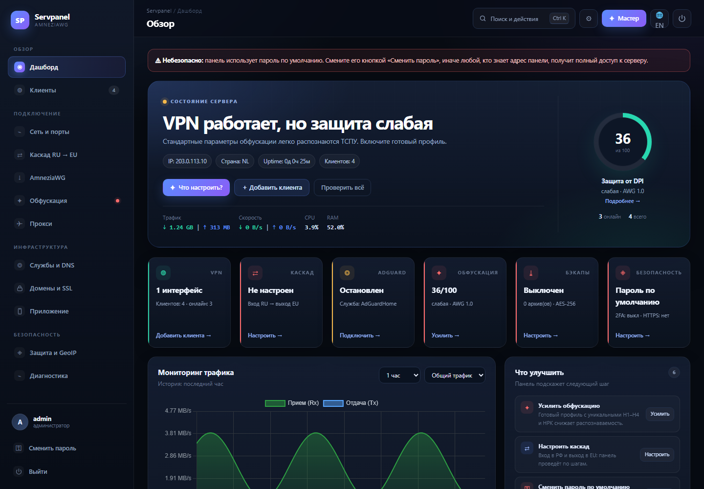
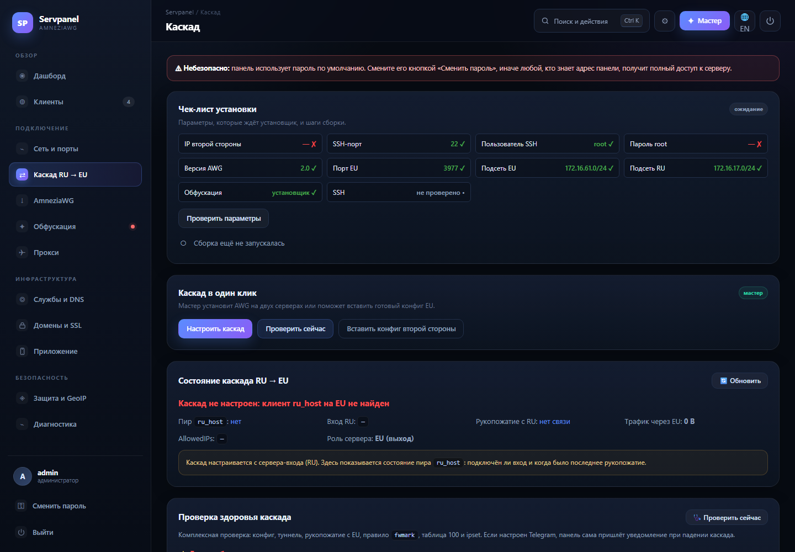
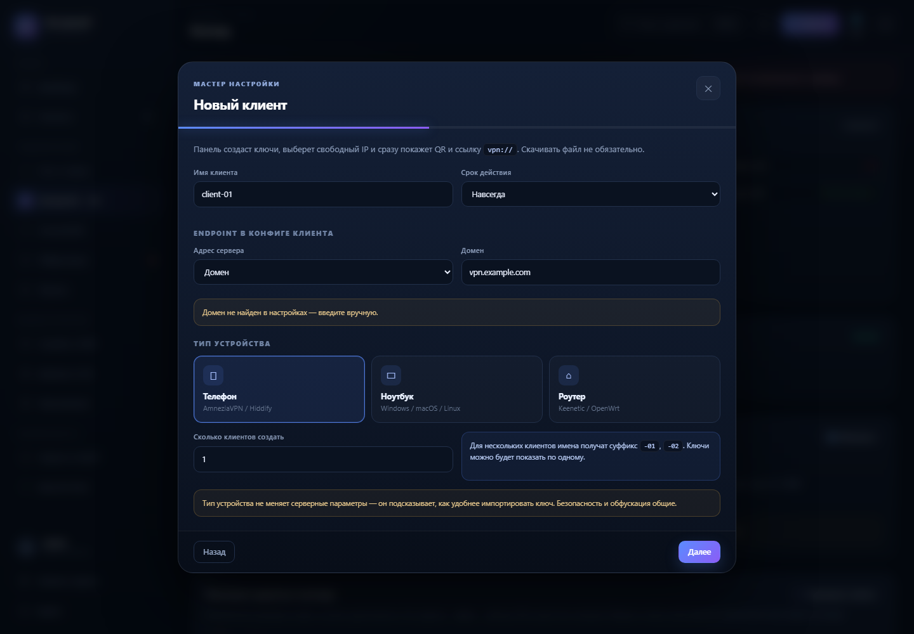
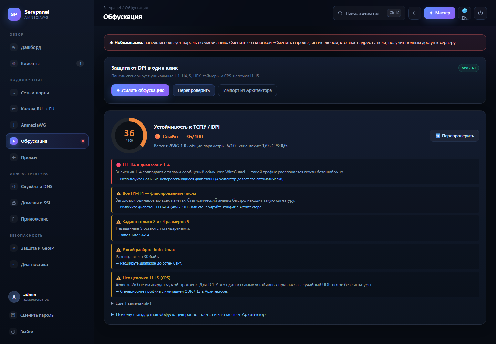
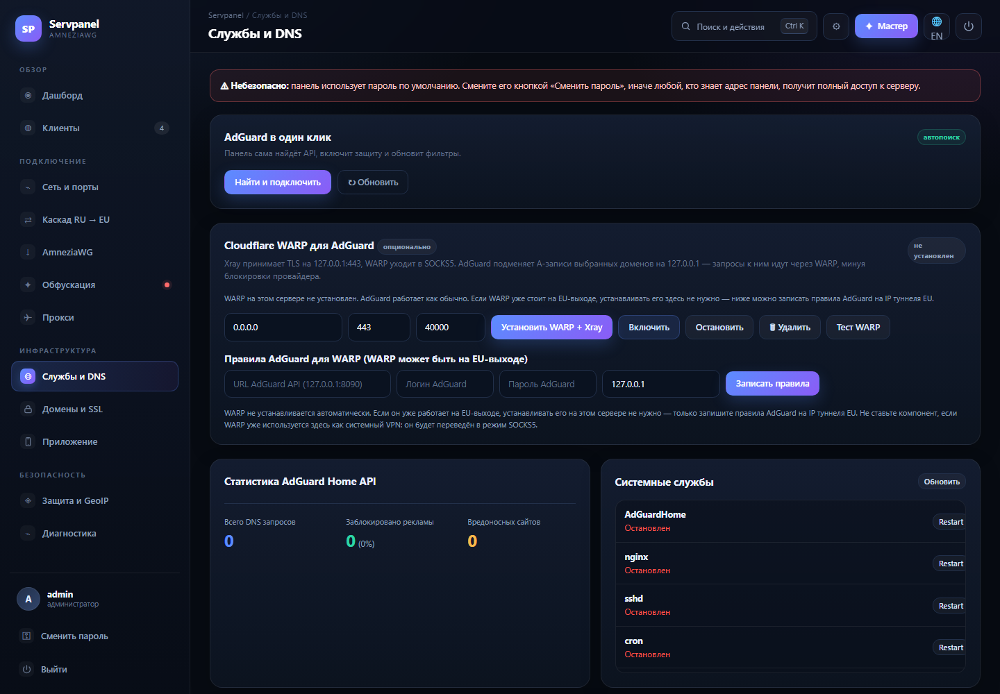
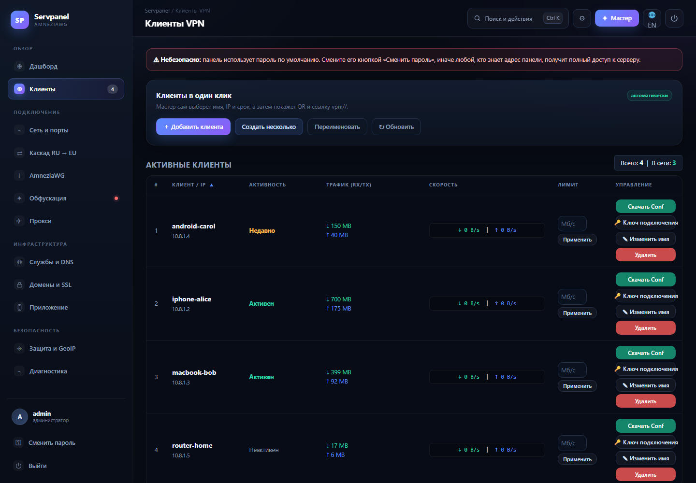

# 🌐 Servpanel 3.0 — Веб-панель управления AmneziaWG & Server Suite

Современная, отказоустойчивая и безопасная веб-панель для управления VPN-сервером **AmneziaWG (версий 3.1 / 2.0 / 1.5)**, каскадом **RU → EU**, правилами фаервола (UFW, GeoIP RU-Drop, DNS-перехват), блокировщиком рекламы **AdGuard Home**, прокси **MTProto (MEKO / MTProxyL)**, доменами и HTTPS-сертификатами **Let's Encrypt**, а также системными службами Linux.

Панель работает напрямую с AmneziaWG (DKMS-модуль ядра) без накладных расходов Docker, обеспечивая максимальную производительность даже на недорогих VPS.

---

## 🆕 Что нового в 3.0

* **Каскад RU → EU из панели.** Мастер по SSH ставит AmneziaWG на второй стороне, создаёт `ru_host`, поднимает `awg1`, настраивает `ipset`/`ip rule`/таблицу 100 и маршруты по CASCADE.md. Есть чек-лист шагов, понятные ошибки, автопродолжение после перезагрузки RU/EU и автоисправление модуля.
* **Статус каскада на EU.** Выходной сервер показывает пир `ru_host`: подключён ли вход RU, endpoint, рукопожатие и трафик — без `awg1.conf`, которого на выходе нет.
* **Обфускация из Архитектора для 2.0 и 3.1.** Генерация H1–H4, S1–S4, Jc/Jmin/Jmax, CPS и (для 3.x) `HeaderProtectionKey`, `ContentPaddingAddition` и таймеров. Для 2.0 учтены ограничения `amneziawg-tools`: H < 2 147 483 647, без тега `<t>`, чётная hex-длина I2–I5; для 3.x тег `<t>` сохраняется.
* **Endpoint клиента: IP или домен.** При создании клиента можно выбрать адрес сервера в конфиге. Домен берётся из `/root/awg_domain.txt` или из привязки «Домен и SSL», иначе вводится вручную.
* **Меню и интерфейс.** Убраны дублирующие карточки, меню перегруппировано: Обзор / Подключение / Инфраструктура / Безопасность / Система.

---

## 🖼 Скриншоты

> Скриншоты с demo-стенда, данные вымышленные.

| | |
|---|---|
| **Дашборд** | **Каскад: чек-лист и статус EU** |
|  |  |
| **Клиент: endpoint IP / домен** | **Обфускация** |
|  |  |
| **Службы и DNS** | **Клиенты** |
|  |  |

---

## 📋 Оглавление
0. [Что нового в 3.0](#-что-нового-в-30)
* [Скриншоты](#-скриншоты)
1. [Системные требования](#-системные-требования)
2. [Быстрый старт (Установка одной командой)](#-быстрый-старт-установка-одной-командой)
3. [Архитектура и как это работает](#-архитектура-и-как-это-работает)
4. [Рекомендованные настройки панели и выбор версии AWG](#-рекомендованные-настройки-панели-и-выбор-версии-awg)
5. [Полный разбор параметров обфускации AmneziaWG](#-полный-разбор-параметров-обфускации-amneziawg)
6. [Совместимость клиентских приложений](#-совместимость-клиентских-приложений)
7. [Где и как лежат файлы (Карта путей на сервере)](#-где-и-как-лежат-файлы-карта-путей-на-сервере)
8. [Домен и SSL (Let's Encrypt)](#-домен-и-ssl-lets-encrypt)
9. [Доступ только по API (без веб-интерфейса)](#-доступ-только-по-api-без-веб-интерфейса)
10. [Прямой HTTPS без Nginx и прокси](#-прямой-https-без-nginx-и-прокси)
11. [Мобильное приложение Servpanel и метрики](#-мобильное-приложение-servpanel-и-метрики)
12. [Обновление и резервное копирование](#-обновление-и-резервное-копирование)
13. [Ручное обновление из терминала](#ручное-обновление-из-терминала-ssh)
14. [Полная инструкция по каскаду RU → EU](КАСКАД.md)

---

## 💻 Системные требования

* **Операционная система:** 
  * **Рекомендуется:** Ubuntu 24.04 LTS или Debian 13 (trixie) — ядро `>= 6.7` с полной поддержкой AmneziaWG 3.1 и 2.0.
  * **Поддерживается:** Ubuntu 26.04, Ubuntu 22.04 LTS, Debian 12 (на ядрах старее `6.7` автоматически собирается стабильная ветка AmneziaWG 2.0).
* **Архитектура:** `x86_64 (amd64)`, `ARM64 (aarch64)`, `ARMv7 (armhf)`.
* **Ресурсы сервера:** Минимум 512 МБ ОЗУ (рекомендуется 1–2 ГБ ОЗУ), 1 vCPU, от 3 ГБ свободного места на диске.
* **Права доступа:** `root` или пользователь с беспарольным `sudo`.

---

## ⚡ Быстрый старт (Установка только панели)

### Способ 1: Автоматическая интерактивная установка через `curl` (Рекомендуется)
Подключитесь к серверу по SSH и выполните одну команду. Скрипт покажет меню:

```
1) Установить панель
2) Удалить панель
3) Выход
```

При установке он спросит **только способ доступа (IP или домен) и порт**. Всё остальное — AmneziaWG, AdGuard Home, каскад и MTProto — настраивается уже из веб-панели:

```bash
curl -fsSL https://raw.githubusercontent.com/AmShaegar-dev/servpanel/main/install.sh | sudo bash
```

*(Если на минимальном образе Debian нет `curl`, выполните: `apt update && apt install -y curl`, либо используйте `wget -qO- https://raw.githubusercontent.com/AmShaegar-dev/servpanel/main/install.sh | sudo bash`)*.

**Что сделает установщик автоматически:**
1. Установит системные зависимости панели (`Node.js 20`, `npm`, `pm2`, `ufw`, `ipset`, `fail2ban`, `sshpass`, `zip`). `nginx` и `certbot` ставятся только при доступе по домену.
2. Развернёт код панели в `/root/servpanel`, установит npm-пакеты и **сгенерирует случайный пароль администратора** (сохраняется в `/root/servpanel/admin_pass.txt`, права `600`).
3. Для домена настроит **Nginx + Let's Encrypt** и обратный прокси на локальный `3000`. Для IP-режима панель слушает выбранный порт напрямую, без Nginx.
4. Добавит в **UFW** разрешения для SSH, порта панели и портов уже установленного AmneziaWG. Сам UFW принудительно не включается — чтобы не оборвать форвардинг существующего VPN.
5. Запустит панель через `PM2` и добавит её в автозагрузку (`pm2 startup` / `pm2 save`).

### Удаление панели из консоли

Тем же скриптом: `curl` → пункт **«Удалить панель»**. Есть два режима:

| Режим | Что удаляется | Что остаётся |
| --- | --- | --- |
| **Только панель** | служба PM2 и автозагрузка, `/root/servpanel`, правила Fail2ban и logrotate, сайт Nginx и сертификат панели, порт панели в UFW | AmneziaWG с клиентами, AdGuard, WARP/Xray, MTProto-прокси |
| **Полная очистка** | всё из первого режима плюс AmneziaWG, AdGuard Home, WARP + Xray и MTProto-прокси (Telemt, MTProxyL, MTProto.zig): службы, конфиги, ключи и их правила UFW | SSH, Node.js, UFW, Nginx, пакеты других сервисов |

Перед удалением данные панели (сессии, пароли, настройки, Telegram-бот) сохраняются в `/root/backups/servpanel-before-remove-<дата>.tar.gz` с правами `600`. Полная очистка требует ввести `DELETE` — без этого сервер не меняется.

Без вопросов (для скриптов):

```bash
# только панель
curl -fsSL https://raw.githubusercontent.com/AmShaegar-dev/servpanel/main/install.sh | sudo ACTION=panel bash

# полная очистка, подтверждение одной строкой
curl -fsSL https://raw.githubusercontent.com/AmShaegar-dev/servpanel/main/install.sh | sudo ACTION=full CONFIRM=DELETE bash
```

Если панель ещё установлена, то же самое доступно локально:
`bash /root/servpanel/uninstall.sh` (или `npm run uninstall`).


После завершения установки панель будет доступна в браузере по адресу:
👉 **`http(s)://ВАШ_IP_ИЛИ_ДОМЕН:<порт>`** — точный адрес и пароль установщик выведет в конце.

**Дальше — из панели:**
1. Войдите под `admin`.
2. Вкладка **«Установка»** → установите **AmneziaWG** (при необходимости — каскад RU → EU).
3. Вкладка **«Службы и DNS»** → установите **AdGuard Home**.
4. Смените пароль администратора в панели.

---

### Способ 2: Ручная установка (через Git)
Если вы хотите развернуть только код панели вручную:
```bash
apt update && apt install -y curl git nodejs npm nginx ufw zip ipset sshpass
npm install -g pm2
git clone https://github.com/AmShaegar-dev/servpanel.git /root/servpanel
cd /root/servpanel
npm install --omit=dev
printf '%s\n' "ВАШ_ПАРОЛЬ" > admin_pass.txt && chmod 600 admin_pass.txt
echo 3000 > .panel_port && echo 3000 > .panel_public_port
pm2 start server.js --name "awg-admin"
pm2 save && pm2 startup
```

---

## 🛠️ Архитектура и как это работает

1. **Связка Nginx ➔ Node.js:**
   Бэкенд панели (`server.js`) слушает внутренний порт (по умолчанию `3000`, хранится в `.panel_port`). Внешние подключения принимает веб-сервер **Nginx** и проксирует их внутрь. Это защищает Node.js от прямого воздействия извне и позволяет легко привязать SSL-сертификаты. В IP-режиме Node слушает выбранный порт напрямую.
2. **Сессии и авторизация:**
   Вход проверяется по паролю из `admin_pass.txt` (сравнение через `timingSafeEqual`), сессия хранится в подписанной cookie `panel.sid` (`HttpOnly`, `SameSite=Lax`, `Secure` при HTTPS). Пять неудачных попыток блокируют IP на 15 минут. Сессии хранятся в файлах и переживают перезапуск панели; запись атомарная, поэтому параллельные запросы не сбрасывают вход.
3. **Автоматическая защита порта панели в UFW (`PANEL_PORT`):**
   При запуске установки любого модуля из веб-интерфейса `server.js` передаёт переменную окружения `PANEL_PORT` (внешний порт из `.panel_public_port`) в bash-обертку. Скрипт принудительно разрешает этот порт, а также `80/tcp`, `443/tcp`, `22/tcp` и `2233/tcp` в UFW **до** и **после** работы установщика AmneziaWG. Вы гарантированно не заблокируете себе вход в админку.
4. **Stateful-установка AmneziaWG с авто-продолжением после ребута:**
   Оригинальный установщик AmneziaWG требует перезагрузок сервера для активации нового ядра и модуля DKMS. Наша обертка `install_awg_stateful.sh` сохраняет выбранные вами в браузере флаги в `/root/awg_install_params.env` и создает временную задачу `@reboot` в `/etc/cron.d/awg_resume`. После перезагрузки сервер сам продолжает установку со следующего шага, а в конце удаляет временные файлы.
5. **Бесконфликтный AdGuard Home (`install_adguard_silent.sh`):**
   По умолчанию AdGuard Home пытается занять порт `3000` для первичной настройки, на котором уже работает бэкенд панели. Наш скрипт заранее создает конфигурацию `/opt/AdGuardHome/AdGuardHome.yaml`, фиксируя веб-интерфейс AdGuard (и уберегая порт `3000` при совпадении), и проводит тихую установку без зависаний.
* DNS-порт AdGuard: 853/tcp (DNS-over-TLS). Plain DNS на 53 в конфиге
  отключён, `systemd-resolved` и `/etc/resolv.conf` установщик не меняет.
  В AdGuard включите «Настройки > Шифрование > DNS-over-TLS» на порту 853.
6. **Аудит и авто-бэкапы:**
   Любое редактирование конфига `/etc/amnezia/amneziawg/awg0.conf` через веб-панель автоматически создает резервную копию вида `awg0.conf.bak_<timestamp>`. Все важные действия (логин, смена пароля, удаление клиентов, установка модулей) записываются с IP-адресом в `/var/log/awg_audit.log`.
7. **Интерфейс-мастер (v2.3):**
   Вместо десятков ручных полей — пошаговые мастера для установки, клиентов, каскада, обфускации, AdGuard, бэкапа и полной проверки. Параметры выбираются готовыми вариантами, панель сама формирует команды. Для тонкой настройки есть «Экспертный режим» и командная палитра (`Ctrl+K`).

---

## 🔒 Доступ только по API (без веб-интерфейса)

Если панелью пользуется только мобильное приложение, HTML-интерфейс можно
выключить целиком. Панель не нужно патчить вручную: режим включается
переменными окружения.

| Переменная | Значение | Что делает |
| --- | --- | --- |
| `PANEL_WEB` | `0` | Не раздаёт `public/`; все не-API адреса отвечают `404`. |
| `PANEL_API_PORT` | например `3443` | Дополнительный порт, который отвечает **только** на `/api/*`. |
| `PANEL_API_HOST` | `0.0.0.0`, `127.0.0.1` или IP VPN | Адрес, на котором слушает API-порт. |
| `PANEL_HOST` | `127.0.0.1` | Основной порт оставить только для localhost/SSH-туннеля. |

Пример запуска (проверено с мобильным клиентом):

```bash
PANEL_PORT=3000 PANEL_HOST=127.0.0.1 \
PANEL_WEB=0 \
PANEL_API_PORT=3443 PANEL_API_HOST=0.0.0.0 \
pm2 start server.js --name awg-admin --update-env
```

В приложении укажите адрес `https://panel.example.com:3443` (или
`http://IP:3443`). Проверка подключения использует `/api/security/status`,
поэтому API-порт определяется корректно.

API-порт автоматически становится **HTTPS**, если панель нашла сертификат:
из `PANEL_TLS_CERT`/`PANEL_TLS_KEY` или из вкладки «Домен и SSL»
(`/etc/letsencrypt/live/<домен>/fullchain.pem`). Без сертификата порт
поднимается по HTTP и панель пишет предупреждение в журнал — в этом режиме
cookie сессии передаётся открытым текстом.

**Важно про безопасность.** Отключение веб-страницы само по себе не уменьшает
поверхность атаки: `/api/*` даёт те же права, что и интерфейс. Обязательно
дополнительно:

- держите API за HTTPS (Nginx с Let's Encrypt) или внутри WireGuard/VPN;
- ограничьте порт в UFW (`ufw allow from <IP> to any port 3443 proto tcp`)
  либо привяжите `PANEL_API_HOST` к адресу VPN-интерфейса;
- включите 2FA и не используйте пароль по умолчанию;
- помните, что сессия `panel.sid` — это полноценный доступ: по HTTP её
  можно перехватить.

Альтернатива без правок `server.js` — оставить панель на `127.0.0.1:3000`
и настроить Nginx, который проксирует только `/api/`:

```nginx
location /api/ {
    proxy_pass http://127.0.0.1:3000;
    proxy_set_header Host $host;
    proxy_set_header X-Forwarded-For $proxy_add_x_forwarded_for;
    proxy_set_header X-Forwarded-Proto $scheme;
}
location / {
    return 404;
}
```

---

## 🔐 Прямой HTTPS без Nginx и прокси

Если не хочется держать перед панелью обратный прокси (Nginx/Caddy), Node.js
может сам слушать HTTPS. Это тот же процесс, что и API, — никаких
дополнительных демонов и цепочек проксирования.

| Переменная | Значение | Что делает |
| --- | --- | --- |
| `PANEL_TLS_PORT` | например `3443` | Включает HTTPS-listener на этом порту. |
| `PANEL_TLS_CERT` | `/etc/ssl/servpanel/fullchain.pem` | Путь к сертификату (цепочка). |
| `PANEL_TLS_KEY` | `/etc/ssl/servpanel/privkey.pem` | Путь к приватному ключу. |
| `PANEL_TLS_HOST` | `0.0.0.0`, `127.0.0.1` или IP VPN | Адрес HTTPS-listener'а (по умолчанию `PANEL_HOST`). |
| `PANEL_HTTP` | `1` | Оставить и обычный HTTP. По умолчанию при включённом TLS HTTP **не** поднимается. |

Пример: только HTTPS, без веб-интерфейса, без HTTP:

```bash
PANEL_WEB=0 PANEL_HTTP=0 \
PANEL_TLS_PORT=3443 \
PANEL_TLS_CERT=/etc/ssl/servpanel/fullchain.pem \
PANEL_TLS_KEY=/etc/ssl/servpanel/privkey.pem \
pm2 start server.js --name awg-admin --update-env
```

В приложении укажите `https://panel.example.com:3443`. Для самоподписанного
сертификата включите в настройках сервера переключатель
«Самоподписанный сертификат».

### Сертификат Let's Encrypt

Порт `80` нужен только на время выпуска/продления — сама панель его не
занимает.

```bash
apt install -y certbot
certbot certonly --standalone -d panel.example.com \
  --deploy-hook "kill -HUP $(pm2 pid awg-admin)"
```

`--deploy-hook` перечитывает сертификат без перезапуска панели: процесс
обрабатывает `SIGHUP` и подменяет TLS-контекст на лету (`setSecureContext`),
активные сессии не рвутся. Тот же эффект даёт `pm2 reload awg-admin`.

### Самоподписанный сертификат

```bash
mkdir -p /etc/ssl/servpanel && cd /etc/ssl/servpanel
openssl req -x509 -newkey rsa:2048 -nodes -days 3650 \
  -keyout privkey.pem -out fullchain.pem \
  -subj "/CN=panel.local" \
  -addext "subjectAltName=DNS:panel.local,IP:203.0.113.10"
chmod 600 privkey.pem
```

В SAN обязательно попадает тот адрес, по которому вы подключаетесь
(домен или IP), иначе приложение будет ругаться даже с включённым
исключением для самоподписанных сертификатов.

### Что это не решает

Прямой HTTPS убирает Nginx из схемы, но **не** делает трафик невидимым для
DPI: это обычный TLS на нестандартном порту. Если задача — устойчивость к
блокировкам, надёжнее не менять порт и сертификат, а не выставлять панель в
интернет вообще:

```bash
# панель слушает только адрес WireGuard-интерфейса
PANEL_TLS_HOST=10.8.0.1 PANEL_TLS_PORT=3443 ...
ufw deny 3443/tcp          # снаружи порт закрыт
```

Тогда панель доступна только из VPN, а мобильное приложение подключается к
`https://10.8.0.1:3443` при поднятом туннеле. Третий вариант — SSH-туннель
(`ssh -L 3443:127.0.0.1:3443 user@server`) с `PANEL_TLS_HOST=127.0.0.1`.

---

## 📱 Мобильное приложение Servpanel и метрики

Вкладка **«Приложение»** в панели собирает всё, что нужно для Android-клиента:
ссылку на APK, адрес API и отдельный порт метрик.

### Скачивание APK

* Кнопка **«Скачать APK»** ведёт на последнюю сборку в релизах
  [servpanel-android](https://github.com/AmShaegar-dev/servpanel-android)
  (`releases/latest/download/servpanel-mobile.apk`).
* Версия в панели берётся из последнего релиза приложения через GitHub API и
  кешируется на 10 минут. Кнопка **«Проверить обновление»** перечитывает её
  принудительно (`GET /api/app/status?refresh=1`).
* Загружать APK в панель больше не нужно: файл не хранится на сервере и не
  устаревает вместе с панелью. Раньше загруженный APK из `DATA_DIR/.app`
  остаётся доступен только если ссылка отключена (`PANEL_APK_URL` пустой).
* Если панель не может достучаться до GitHub, показывается версия из
  `app/version.txt` и предупреждение. Скачивание при этом всё равно работает:
  браузер идёт на GitHub напрямую.

Порядок поиска локального файла (только когда `PANEL_APK_URL` пустой):
`APP_DIR/app/servpanel.apk` → `APP_DIR/public/downloads/servpanel.apk` →
`APP_DIR/servpanel.apk`. Версия для подписи берётся из `app/version.txt`
или из `PANEL_APK_VERSION`.

| Переменная | Значение | Что делает |
| --- | --- | --- |
| `PANEL_APK_URL` | ссылка на последний APK | Внешняя ссылка для скачивания. Пустая — отдавать локальный файл. |
| `PANEL_APK_VERSION` | `1.4.5` | Версия APK для отображения (перекрывает GitHub). |
| `PANEL_APK_REPO` | `AmShaegar-dev/servpanel-android` | Репозиторий релизов приложения. |
| `PANEL_GITHUB_REPO` | `owner/repo` | Репозиторий панели для обновлений. |

### Порт метрик: внутренний и внешний

Метрики — это загрузка CPU, RAM и диска, число клиентов и текущая скорость.
Они отдаются двумя способами:

1. **`GET /api/metrics`** на основном адресе панели — с обычной авторизацией
   (`panel.sid`). Подходит приложению и не требует отдельных портов.
2. **Отдельный listener** — для приложений без сессии, Prometheus и внешнего
   мониторинга. Включается во вкладке «Приложение».

У отдельного listener два порта:

* **внутренний** (`port`) — реальный порт, который слушает Node;
* **внешний** (`publicPort`) — порт, по которому к нему обращаются снаружи
  (например, через NAT, проброс портов или UFW). Если они совпадают,
  достаточно одного значения.

| Переменная | По умолчанию | Что делает |
| --- | --- | --- |
| `PANEL_METRICS_ENABLED` | `0` | `1` — запускать отдельный listener при старте. |
| `PANEL_METRICS_HOST` | `127.0.0.1` | Адрес прослушивания. `0.0.0.0` — открыть наружу. |
| `PANEL_METRICS_PORT` | `9101` | Внутренний порт. |
| `PANEL_METRICS_PUBLIC_PORT` | = `PANEL_METRICS_PORT` | Внешний порт для ссылок и UFW. |
| `PANEL_METRICS_FORMAT` | `json` | `json` или `prometheus`. |
| `PANEL_METRICS_TOKEN` | — | Bearer-токен. Обязателен при не-loopback адресе. |
| `PANEL_METRICS_TLS` | `auto` | `auto` — HTTPS, если найден сертификат; `0` — только HTTP; `1` — требовать TLS. |

Если включить метрики на `0.0.0.0` без токена, панель **сгенерирует токен
сама** (64 hex-символа) и покажет его один раз в интерфейсе. Токен передаётся
заголовком `Authorization: Bearer <токен>`, альтернативы —
`X-Metrics-Token` или `?token=`.

```bash
# JSON
curl -H "Authorization: Bearer <токен>" https://panel.example.com:9101/metrics

# Prometheus
curl -H "Authorization: Bearer <токен>" https://panel.example.com:9101/metrics.prom

# Проверка живости (без токена)
curl https://panel.example.com:9101/health
```

Настройки метрик и APK хранятся в `DATA_DIR/.app_settings.json` (права
`600`) и не перезаписываются при обновлении панели.

### API для приложения

| Метод | Путь | Доступ | Назначение |
| --- | --- | --- | --- |
| `POST` | `/api/login` | без сессии | Вход по паролю, ставит cookie `panel.sid`. |
| `GET` | `/api/security/status` | сессия | Проверка адреса и версии. |
| `GET` | `/api/sysinfo` | сессия | CPU, RAM, диск, uptime. |
| `GET` | `/api/metrics` | сессия | Компактный снимок метрик (JSON). |
| `GET` | `/api/app/status` | сессия | APK, адрес API, настройки метрик и предупреждения. |
| `GET` | `/api/app/apk` | сессия | Скачать APK (`302` на последний релиз приложения). |
| `POST` | `/api/app/metrics` | админ | Сохранить и сразу применить настройки метрик. |
| `POST` | `/api/app/metrics/token` | админ | Сгенерировать новый токен метрик. |

В Android-приложении эти значения вводятся в редакторе сервера: **«Порт
метрик»** и **«Токен метрик»**. Если порт не указан, приложение берёт
сводку из `/api/sysinfo`; если указан — сначала пробует `/metrics` (быстрее
и работает без входа), а при ошибке откатывается на API.

---

## 🎯 Рекомендованные настройки панели и выбор версии AWG

Во вкладке **«Установка»** вы можете детально настроить будущий сервер AmneziaWG перед запуском.

### Какую версию протокола выбрать (`3.1` vs `2.0` vs `1.5`)?

| Версия | Описание и особенности | Кому подходит (Рекомендация) |
| :--- | :--- | :--- |
| **Версия 3.1** *(Последняя)* | Включает шифрование заголовков ChaCha20 (`HeaderProtectionKey`) и случайный внутренний паддинг (`ContentPaddingAddition`). Параметры `H1–H4` фиксируются как `1..4`, так как заголовок полностью зашифрован. | Выбирайте, если **все ваши устройства** используют свежие клиенты (AmneziaVPN `>= 5.0.1.5`, AmneziaWG Windows `>= 3.1.0`, Android/iOS `>= 3.1.4`). Максимальная защита от ТСПУ. |
| **Версия 2.0** *(Стабильная)* | Использует динамические диапазоны заголовков `H1–H4`, паддинги `S1–S4`, мусорные пакеты `Jc/Jmin/Jmax` и CPS-маскировку `I1` (имитация DNS/QUIC). | **Универсальный выбор по умолчанию.** Работает везде: на стоковых прошивках роутеров (KeeneticOS 4.x/5.x), Hiddify, старых клиентах из Google Play и десктопах. |
| **Версия 1.5** *(Legacy)* | Классическая базовая обфускация первого поколения (без `S3/S4` и без CPS-тегов `I1`). | Только для устаревшего оборудования и клиентов первого поколения, которые выдают ошибку на ключ `S3` или `I1`. |

### Как ставится AWG в панели

Начиная с 2.7.0 установка AWG **стандартная**: панель не предлагает пресеты
`default`/`mobile` и не передаёт `--preset`. Используются рекомендованные
параметры:

1. **Версия протокола:** `3.1` по умолчанию, `2.0` и `1.5` доступны в
   «Дополнительных параметрах» для старых клиентов.
2. **UDP-порт:** `443` по умолчанию. Для мобильных сетей это лучший выбор:
   операторы пропускают `443/udp` как QUIC/HTTP3. Порт можно изменить в
   «Дополнительных параметрах».
3. **Маршрутизация (IPv4):**
   * **Весь трафик (`0.0.0.0/0`)** — рекомендуется.
   * **Список Amnezia + DNS** — публичный интернет через VPN, локальные
     подсети напрямую.
   * **Пользовательский список** — split-tunnel.
4. **IPv6:** `disallow` — чтобы не было утечки реального IP по IPv6.
5. **Чекбоксы безопасности:**
   * ✅ **Изолировать клиентов друг от друга (`isolation=on`)** — правило
     `iptables DROP` между пирами внутри `awg0`.
   * ✅ **Сохранить системные пакеты (`--keep-packages`)** — без этой
     галочки оригинальный скрипт удаляет `snapd`, `lxd` и их данные.
   * ⬜ **Без UFW, Fail2Ban и оптимизаций (`--no-tweaks`)** — оставьте
     выключенным. Панель сама открывает нужные порты в UFW.

### Откуда взять конфигурацию обфускации

Параметры обфускации больше не выбираются при установке. После установки
есть три равнозначных пути:

* **Архитектор** — [architect.vai-rice.space/amneziawg](https://architect.vai-rice.space/amneziawg/).
  Сгенерируйте профиль и импортируйте `.conf` в панель.
* **Встроенный мастер** — вкладка «Установка» → «Сгенерировать в панели»
  (или мастер **«Усиление обфускации»**). Панель сама создаст диапазоны
  `H1–H4`, `S1–S4`, `Jc/Jmin/Jmax`, `HeaderProtectionKey` и цепочки `I1–I5`.
  В мастере можно указать **SNI для TLS-мимикрии** — тогда `I1` содержит
  настоящий TLS ClientHello с этим доменом.
* **Импорт `.conf`** — вкладка «Обфускация» → экспертный режим (⚙) →
  «Импорт из Архитектора».

Прямые кнопки для всех трёх путей есть в карточке AWG на вкладке
«Установка».

---

## 🔬 Полный разбор параметров обфускации AmneziaWG

Все параметры обфускации генерируются при установке и прописываются в секции `[Interface]` серверного конфига (`/etc/amnezia/amneziawg/awg0.conf`) и клиентских файлов. Вы можете редактировать их прямо в веб-панели во вкладке **«Сеть и фаервол» ➔ «Редактор конфигурации AmneziaWG»**.

### 1. Мусорные пакеты (Junk Packets) — сбивают сигнатурный анализ старта сессии
Перед отправкой настоящего пакета установки соединения (Handshake Initiation) клиент отправляет серию случайных пакетов-обманок:
* **`Jc` (Junk packet count):** Количество мусорных пакетов перед рукопожатием. Диапазон: `3–6` (`0` — отключает).
* **`Jmin` (Junk packet minimum size):** Минимальный размер мусорного пакета в байтах (обычно `40–89` байт).
* **`Jmax` (Junk packet maximum size):** Максимальный размер мусорного пакета в байтах (должен быть `>= Jmin`, обычно до `250` байт).

### 2. Паддинг пакетов (`S1 – S4`) — маскировка фиксированной длины WireGuard
Обычный WireGuard мгновенно вычисляется ТСПУ по жестко фиксированным размерам пакетов рукопожатия. AmneziaWG добавляет случайный префикс (мусорные байты в начале пакета) к каждому типу сообщений:
* **`S1`:** Паддинг `Init`-сообщения (запрос рукопожатия). Диапазон: `15–150` байт.
* **`S2`:** Паддинг `Response`-сообщения (ответ сервера). Диапазон: `15–150` байт. *(Критическое правило: `S1 + 56 ≠ S2`, чтобы итоговые размеры запросов и ответов никогда не совпадали)*.
* **`S3`:** Паддинг `Cookie`-сообщения (защита от перегрузки). Диапазон: `8–55` байт *(правило: `S3 ≠ S2 + 28`)*.
* **`S4`:** Паддинг `Data`-сообщений (обычные пакеты с данными). Диапазон: `4–27` байт.

### 3. Подмена заголовков типов сообщений (`H1 – H4`)
В стандартном WireGuard первые 4 байта всегда равны `1`, `2`, `3` или `4` (тип пакета). AmneziaWG заменяет их:
* **`H1`:** Идентификатор `Init`-пакета.
* **`H2`:** Идентификатор `Response`-пакета.
* **`H3`:** Идентификатор `Cookie`-пакета.
* **`H4`:** Идентификатор `Data`-пакета.
* **Особенности в версиях:** 
  * В **AWG 2.0** `H1–H4` задаются **непересекающимися диапазонами** чисел `uint32` (например, `H1 = 134567-245678`) — при каждом пакете берется случайное число из диапазона. *(Для старых прошивок роутеров Keenetic их можно заменить на одиночные числа).*
  * В **AWG 3.1** `H1–H4` оставляют равными `1, 2, 3, 4`, так как сам заголовок полностью шифруется алгоритмом ChaCha20 через ключ `HeaderProtectionKey`.

### 4. CPS-маскировка протокола (`I1 – I5` / Custom Protocol Signature)
Самый мощный инструмент против ТСПУ и блокировок по AS хостера (например, Hetzner, OVH, DigitalOcean). Перед рукопожатием отправляется специально сконструированный пакет `I1`, который имитирует легитимный сетевой протокол (DNS-ответ или QUIC-рукопожатие к разрешенному сайту).
Формат строки `I1` собирается из специальных тегов:
* **`<r N>`:** Сгенерировать `N` криптографически случайных байт (например, `<r 2>` в начале создает 2 случайных байта для DNS Transaction ID, чтобы пакеты не были одинаковыми).
* **`<b 0xHEX>`:** Вставить точную последовательность байт в формате HEX (например, структуру заголовка DNS или QUIC SNI).
* **`<rc N>`:** Сгенерировать `N` случайных ASCII-символов (буквы/цифры) — имитирует случайные поддомены в запросе.
* **`<rd N>`:** Сгенерировать `N` случайных цифр.
* **`<t>`:** Вставить текущий Unix Timestamp (4 байта).
* **`<c>`:** Счетчик пакетов.
* *Пример дефолтного `I1` (маскировка под DNS-ответ iCloud):*
  `I1 = <r 2><b 0x8580000100010000000025><rc 37><b 0x0463646e730669636c6f756403636f6d0000010001c00c00010001000003840004524b6bc2>`
* **`I2 – I5`:** Опциональные дополнительные пакеты маскировки (по умолчанию не требуются).

### 5. Эксклюзивные параметры поколения AmneziaWG 3.1
* **`HeaderProtectionKey`:** 256-битный ключ в Base64 для криптографического шифрования заголовков пакетов (ChaCha20). **Требование:** при использовании этого ключа значения `S1–S4` обязаны быть **не меньше `12`**, так как первые 12 байт паддинга используются как `nonce` для шифрования.
* **`ContentPaddingAddition`:** Диапазон дополнительного внутреннего паддинга внутри зашифрованной полезной нагрузки (например, `32-128`). Убирает любые статистические приметы длины передаваемых данных.
* **Тайминги в формате диапазонов (опционально в 3.1):** `RekeyAfterTime`, `RekeyTimeout`, `RejectAfterTime`, `KeepaliveTimeout` (например, `20-30`) — позволяют рандомизировать интервалы служебных пакетов.

### ⚠️ Главное правило: что ОБЯЗАНО совпадать на сервере и клиенте, а что нет?

| Параметр | Обязан совпадать у сервера и клиента? | Что будет при несовпадении / Примечание |
| :--- | :---: | :--- |
| **`S1`, `S2`, `S3`, `S4`** | ✅ **ДА (Строго)** | Приемник срезает ровно `S` байт со старта пакета. Если числа разные — пакет не распознается (0% связи). |
| **`H1`, `H2`, `H3`, `H4`** | ✅ **ДА (Строго)** | Отправитель берет число из диапазона, приемник проверяет вхождение в свой диапазон. Должны быть идентичны. |
| **`HeaderProtectionKey`** *(в 3.1)* | ✅ **ДА (Строго)** | Если ключ есть только на одной стороне или ключи разные — 100% потерь, рукопожатие не соберется молча. |
| **`Jc`, `Jmin`, `Jmax`** | ❌ **НЕТ (Односторонние)** | Это пакеты-пустышки, принимающая сторона их просто отбрасывает. Клиент может менять свой `Jc` локально. |
| **`I1 – I5` (CPS)** | ❌ **НЕТ (Односторонние)** | Маскировочный пакет шлет инициатор для пробития ТСПУ по пути. Вторая сторона его игнорирует. |
| **`ContentPaddingAddition`** *(в 3.1)*| ❌ **НЕТ (Односторонний)** | Внутренний паддинг обрабатывается прозрачно внутри расшифрованной структуры. |

---

## 📱 Совместимость клиентских приложений

| Приложение | Платформа | Поддержка AWG 3.1 | Поддержка AWG 2.0 | Формат импорта |
| :--- | :--- | :---: | :---: | :--- |
| **Amnezia VPN** *(Официальный клиент)* | Windows, macOS, Linux, Android, iOS | ✅ (с `v5.0.1.5+`) | ✅ (с `v4.8.12.7+`) | `.conf`, QR-код, `vpn://` URI |
| **AmneziaWG** *(Легковесный клиент)* | Windows | ✅ (с `v3.1.0+`) | ✅ (с `v2.0.0+`) | `.conf` файлы |
| **AmneziaWG** *(Легковесный клиент)* | Android (GitHub APK), iOS (App Store) | ✅ (с `v3.1.4+`) | ✅ (с `v2.0.0+`) | `.conf`, QR-код |
| **WG Tunnel** *(FOSS клиент)* | Android, Windows, Linux | ✅ (с `v5.6.0+`) | ✅ | `.conf`, QR-код, Auto-tunnel |
| **Роутеры Keenetic (KeeneticOS)** | Нативный клиент прошивки 4.x / 5.x | ❌ *(Только через Entware AWG Manager v2.17.4+)* | ✅ Встроено | `.conf` файлы |

---

## 📂 Где и как лежат файлы (Карта путей на сервере)

### 1. Файлы веб-панели
* `/root/servpanel/` — Корневая рабочая папка веб-панели.
* `/root/servpanel/server.js` — Бэкенд-сервер на Node.js (Express).
* `/root/servpanel/public/index.html` — Фронтенд панели (HTML/CSS/JS, графики Chart.js).
* `/root/servpanel/admin_pass.txt` — Файл с текущим паролем от веб-панели (создаётся установщиком и при смене пароля, права `600`). Если файла нет, действует устаревший пароль `admin123` — панель покажет красное предупреждение.
* `/root/servpanel/.secrets.json` — Случайный секрет сессий (создаётся автоматически, права `600`, **не коммитится в git**).
* `/root/servpanel/.panel_port` и `.panel_public_port` — Внутренний порт Node и внешний порт панели (обновление больше не сбрасывает кастомный порт).
* `/root/servpanel/install_awg_stateful.sh` — Скрипт-обертка для автономной установки AmneziaWG с поддержкой перезагрузок.
* `/root/servpanel/install_adguard_silent.sh` — Скрипт тихой установки AdGuard Home.
* `/etc/nginx/sites-available/awg-admin` — Конфигурация виртуального хоста Nginx (порт задаётся при установке: `443` по умолчанию).

### 2. Файлы AmneziaWG и Клиентов
* `/etc/amnezia/amneziawg/awg0.conf` *(или `amn0.conf`)* — **Главный серверный конфигурационный файл** интерфейса AmneziaWG (содержит настройки обфускации `[Interface]` и список всех пиров `[Peer]`).
* `/etc/amnezia/amneziawg/awg0.conf.bak_*` — Автоматические бэкапы серверного конфига, создаваемые панелью перед каждым сохранением изменений.
* `/root/awg/` — Главная директория скриптов управления и профилей клиентов:
  * `/root/awg/awgsetup_cfg.init` — Файл глобальных параметров установки AWG (выбранная версия протокола, пресет, порт, подсеть, ключи обфускации, `CLIENT_DNS`).
  * `/root/awg/manage_amneziawg.sh` — CLI-скрипт управления клиентами (`add`, `remove`, `list`, `stats`, `regen`, `modify`, `backup`).
  * `/root/awg/awg_common.sh` — Библиотека генерации ключей и шаблонов.
  * `/root/awg/server_private.key` и `server_public.key` — Ключи сервера (права `600`).
  * `/root/awg/keys/` — Директория с приватными и публичными ключами каждого клиента.
  * `/root/awg/expiry/` — Метки времени (Unix timestamp) для временных клиентов (`--expires`), проверяются задачей `/etc/cron.d/awg-expiry` каждые 5 минут.
  * `/root/awg/<имя>.conf` — Готовый конфигурационный файл клиента (скачивается из панели).
  * `/root/awg/<имя>.png` и `<имя>.vpnuri` — QR-код и текстовая ссылка `vpn://` для быстрого импорта в AmneziaVPN.

### 3. Сетевые утилиты и Службы
* `/root/awg/ru-drop.sh` и `/etc/cron.d/ru-drop-refresh` — Скрипт и cron-задача блокировки исходящего трафика на российские IP-диапазоны через `ipset` (`ru_block`) для защиты сервера от жалоб и сканирования. Источник можно выбрать: OpenCCK Russia (CIDR российских сервисов: Сбер, VK, Яндекс, Ozon и др.), Antifilter/ipdeny (полная зона РФ), свой URL или загруженный файл. Длинные OpenCCK-ссылки с `site=...` поддерживаются (до 8192 символов). Из файла любого текстового формата (TXT, CSV, JSON, ipset) автоматически извлекаются IPv4/CIDR.
* `/root/awg-limit.sh` — Скрипт шейпера трафика (`tc`) для ограничения скорости конкретным IP-адресам клиентов.
* `/etc/sysctl.d/99-amneziawg-security.conf` — Тюнинг ядра Linux (IP forwarding, TCP BBR, сетевые буферы).
* `/opt/AdGuardHome/AdGuardHome.yaml` — Конфигурационный файл DNS-сервера AdGuard Home.

### 4. Логи и Журналы диагностики
* `/var/log/awg_audit.log` — **Журнал безопасности панели** (история входов, неудачных попыток пароля, удалений клиентов, правок конфига).
* `/var/log/awg_install.log` — Полный лог установки AmneziaWG (транслируется в терминал внутри браузера).
* `/var/log/adguard_install.log` — Лог установки AdGuard Home.
* `/root/awg/install_amneziawg.log` и `manage_amneziawg.log` — Внутренние логи установщика и менеджера клиентов.
* `~/.pm2/logs/awg-admin-error.log` — Лог ошибок Node.js процесса панели (просмотр: `pm2 logs awg-admin`).

### 5. Сертификаты Let's Encrypt (вкладка «Домен и SSL»)
* `/etc/letsencrypt/live/<домен>/fullchain.pem` — **сертификат + цепочка** (этот путь указывается в `ssl_certificate`).
* `/etc/letsencrypt/live/<домен>/privkey.pem` — **приватный ключ** (доступен только `root`, права `600`).
* `/etc/letsencrypt/live/<домен>/cert.pem` и `chain.pem` — сертификат и промежуточная цепочка по отдельности.
* `/etc/letsencrypt/archive/<домен>/` — реальные файлы; в каталоге `live/` лежат символические ссылки.
* `/etc/letsencrypt/renewal/<домен>.conf` — параметры автопродления (таймер `certbot.timer`).
* `/var/www/<домен>/` — файлы сайта, созданного из панели (замените `index.html` своим содержимым).
* `/etc/nginx/sites-available/<домен>` — конфигурация сайта; перед изменением панель делает резервную копию и откатывается при ошибке `nginx -t`.

---

## 🔀 Каскад RU → EU (раздельный выход)

> 📖 **Подробное руководство со всеми кнопками, механикой, настройкой и разбором ошибок —
> в отдельном файле: [КАСКАД.md](КАСКАД.md).**

Панель умеет собирать каскад по официальной схеме [CASCADE.md](https://github.com/bivlked/amneziawg-installer/blob/main/CASCADE.md) без ручного редактирования iptables.

**Автоматическая сборка (рекомендуется).** На RU-сервере откройте вкладку **«Каскад»**, укажите роль, версию AWG (2.0 или 3.1), IP/SSH-порт/пользователя/пароль второй стороны и нажмите **«Построить каскад»**. Панель по SSH:

* поставит AmneziaWG на EU (если нужно), применит обфускацию и создаст клиента `ru_host`;
* поставит/проверит AmneziaWG на RU, применит обфускацию и перегенерирует клиентские конфиги;
* создаст `/etc/amnezia/amneziawg/awg1.conf` (уберёт `DNS`, добавит `Table = off`);
* поднимет `awg-quick@awg1` и только после этого применит маршруты;
* сгенерирует `/root/awg/awg-routing.sh` с `ipset ru`, `ip rule fwmark`, таблицей 100 и NAT;
* включит `awg-routing.timer` — список российских сетей обновляется ежедневно в 01:00 с разбросом.

Во время сборки на вкладке виден **чек-лист**: SSH, установка EU, обфускация, `ru_host`, установка RU, `awg1`, туннель, маршруты, рукопожатие, трафик. Ошибка подсвечивается на конкретном шаге с текстом. Если RU или EU перезагружается, панель продолжает сборку автоматически, а не начинает её заново.

**Ручной режим.** На EU создайте клиента `manage_amneziawg.sh add ru_host`, скачайте `ru_host.conf`, вставьте его в панель на RU, выберите интерфейсы и нажмите **«Настроить каскад»**. Панель сделает те же шаги, что и автоматическая сборка.

**Статус на EU.** На выходном сервере карточка каскада привязана к пиру `ru_host` в `awg0.conf`: показывает, подключён ли вход RU, endpoint входа, последнее рукопожатие, трафик и `AllowedIPs`. Если пира нет — «Каскад не настроен», если обмен старый — «вход RU потерян».

**Интерфейсы.** В блоке «Интерфейсы маршрутизации» галочками выбираются интерфейсы, трафик которых уходит в каскад (обычно `awg0`). Подсеть каждого берётся из его адреса, поэтому интерфейсы можно добавлять после установки и нажимать **«Применить»**.

**MTProto-прокси через каскад (опция).** В том же разделе есть переключатель «Пускать исходящие соединения Telemt через EU». Порт при этом не создаётся: панель помечает только новые исходящие соединения процесса `telemt` (uid + conntrack + `CONNMARK`), поэтому они уходят в `awg1`, а ответы клиентам, подключённым к RU, остаются напрямую. Исключены RU-сети, адрес EU, loopback и приватные подсети. После включения Telemt перезапускается; кнопка «Проверить выход прокси» сравнивает IP Telemt, EU и RU. Опция выключена по умолчанию.

Дополнительные российские сети (например, корпоративные подсети) можно перечислить в поле «Свои адреса через РФ» — они пойдут напрямую, минуя EU.

---

## 🧩 Обфускация и сайт-Архитектор

Вкладка **«Обфускация»** интегрирована с генератором [AmneziaWG Architect](https://architect.vai-rice.space/amneziawg/):

* **оценка устойчивости к ТСПУ/DPI** — панель разбирает текущие параметры и показывает балл 0–100, версию AWG и конкретные признаки: `H1–H4 = 1–4`, фиксированные заголовки, отсутствие CPS, HeaderProtectionKey или таймеров;
* **импорт из Архитектора** принимает `.conf`, JSON (формат Amnezia `VpnConfig`), `vpn://` и batch-вывод. Панель извлекает только параметры обфускации, **сохраняет диапазоны** вида `H1 = 511866868-511879290` и `ContentPaddingAddition = 16-128` (старая версия обрезала их до первого числа), проверяет пересечения H, `S4 ≤ 32`, длину `I1–I5 ≤ 3200` и корректность `HeaderProtectionKey`;
* **предпросмотр до применения** — показывает формат, версию, добавленные/изменённые/удалённые параметры и замечания аудита;
* **безопасное применение** — резервная копия, запись, перезапуск `awg-quick@…`, проверка `is-active`; при ошибке конфиг автоматически откатывается. Если не удалось перегенерировать клиентов, сервер тоже возвращается к прежним параметрам;
* **перегенерация клиентов** — галочка `regen` пересобирает конфиги всех клиентов; без неё старые устройства потеряют связь;
* **профили** — встроенные наборы помечены уровнем (слабый/средний) и оценкой; импорт можно сохранить как свой профиль;
* **batch** — при нескольких конфигурациях берётся первая, остальные показываются как альтернативы для других устройств.

Поддерживаются параметры AmneziaWG 3.1: `RandomTrailers`, `DisableCookies`, `RekeyAfterTime`, `RekeyTimeout`, `RejectAfterTime`, `KeepaliveTimeout`, `MaxHandshakeAttempts`, `ContentPaddingAddition` и `HeaderProtectionKey`.

Важно: обфускация меняет только внешний вид трафика. Если провайдер блокирует IP сервера, она не поможет — нужен другой адрес или хостинг.

---

## 👥 Клиенты: имена и ключи

* **Переименование** — кнопка «✎ Изменить имя» в таблице клиентов. Меняются только имя и файлы; ключи и IP остаются прежними, устройствам не нужно переподключаться. Также есть массовое переименование (например, убрать `paris` из всех имён одним действием).
* **Ключ подключения** — кнопка «🔑 Ключ подключения» показывает ссылку `vpn://` и QR-код для импорта в AmneziaVPN (вместо скачивания файла). Ссылка генерируется установщиком; если файла `.vpnuri` нет, панель собирает её сама из `.conf`.
* **Один файл на клиента** — кнопка «📄 Файл-инструкция» отдаёт автономный HTML: QR-код, ссылка `vpn://`, `.conf` и инструкция. Его можно открыть на телефоне или отправить пользователю — панель для этого уже не нужна.
* **Endpoint: IP или домен** — при создании клиента можно выбрать, что попадёт в `Endpoint`: IP сервера или домен. Домен панель берёт из `/root/awg_domain.txt` или из привязки «Домен и SSL», показывает источник и даёт исправить вручную, если домен не найден. Выбор сохраняется: при скачивании `.conf` и в `vpn://` панель не подменяет IP доменом. Уже созданные клиенты не меняются.
* **Массовое создание** — после выпуска панель показывает кнопку «Скачать созданные конфиги»: все `.conf` приходят одним ZIP, без десятка отдельных скачиваний.
* **Имя сервера** — в «Клиентах» задаётся отображаемое имя. Оно попадает в `vpn://` как название сервера и в имена скачиваемых файлов вместо `Serv_`.

---

## ▣ RustDesk

Свой **ID/relay-сервер RustDesk** без Docker и без платной подписки. Панель ставит официальные пакеты `hbbs`/`hbbr` из GitHub, настраивает systemd и открывает порты.

* **Адрес сервера** — IP или домен. Домен должен указывать A-записью на сервер. После смены адреса `hbbs` перезапускается.
* **Порты** — `21115/tcp`, `21116/tcp`, `21116/udp`, `21117/tcp`. Для веб-клиента дополнительно `21118/tcp` и `21119/tcp`.
* **Ключ сервера** — панель показывает публичный ключ из `/var/lib/rustdesk-server/id_ed25519.pub`. Его нужно ввести в клиенте вместе с ID-сервером и Relay.
* **Клиенты** — Windows `.exe`/`.msi`, Android ARM64/Universal/ARMv7, Linux `.deb`/`.rpm`/AppImage. Панель берёт последнюю версию из `rustdesk/rustdesk` и кэширует только её; старые версии удаляются.
* **Обновление сервера** — кнопка «Обновить с GitHub» скачивает новые `.deb` из `rustdesk/rustdesk-server`, устанавливает и перезапускает службы. Ключи и база клиентов сохраняются, перед обновлением делается резервная копия бинарников.
* **Инструкция** — кнопка «Инструкция» открывает готовую страницу с адресом, Relay, ключом и шагами для Windows/Android/Linux.

Источники: [rustdesk/rustdesk](https://github.com/rustdesk/rustdesk) (клиенты, AGPL-3.0) и [rustdesk/rustdesk-server](https://github.com/rustdesk/rustdesk-server) (сервер).

## 🛡️ AdGuard Home

Вкладка «Службы и DNS» получила полноценное управление AdGuard Home (Basic-auth, API v0.107+):

* статус и версия, включение/выключение защиты;
* статистика запросов и блокировок;
* список постоянных и автоматических клиентов;
* журнал последних запросов;
* список фильтров и принудительное обновление.

Логин и пароль AdGuard хранятся только в `sessionStorage` текущей вкладки и очищаются при её закрытии.

### Cloudflare WARP для AdGuard (опционально)

WARP не устанавливается автоматически. На вкладке **«Службы и DNS»** есть отдельная карточка **«Cloudflare WARP для AdGuard»**; пока её не открыть и не нажать «Установить», панель работает как обычно.

Что делает компонент:

* ставит `cloudflare-warp` и переводит его в SOCKS5-режим на `127.0.0.1:40000`;
* ставит Xray и слушает TLS на IP туннеля AWG (по умолчанию `10.8.1.1:443`);
* Xray сниффит SNI и отправляет соединение в SOCKS5 WARP;
* кнопка «Записать правила» добавляет в AdGuard блок `dnsrewrite` для доменов из `warp-domains.txt` (200 доменов) на IP туннеля.

Почему IP туннеля, а не публичный IP: так трафик клиента идёт через AWG-каскад, а не напрямую на EU-сервер. Если WARP блокируется в РФ, устанавливайте компонент на EU-выходе и указывайте его туннельный IP. Правила AdGuard при этом записываются из панели RU-входа: WARP на RU ставить не нужно, достаточно указать IP туннеля EU в поле «IP для dnsrewrite».

Правила в AdGuard обрамляются маркерами `# BEGIN SERVEPANEL WARP` / `# END SERVEPANEL WARP`, поэтому повторная синхронизация заменяет только блок панели и не трогает остальные пользовательские правила.

Не ставьте Xray на `0.0.0.0`, если не хотите открыть вход на публичный IP. По умолчанию панель предлагает `10.8.1.1`.

Компонент переводит Cloudflare WARP в режим `proxy` (SOCKS5 на localhost). Если WARP уже используется на этом сервере как системный VPN, не устанавливайте компонент: режим будет изменён.

---

## ✈️ MTProto / WEB Proxy (MEKO)

Вкладка **«Установка»** содержит карточку **«MTProto / WEB Proxy (MEKO)»**
и кнопку **«Установить MTProto»**. Мастер сначала спрашивает все параметры,
а затем запускает установщик MEKO **без единого вопроса** — в том числе по
SSH, из панели.

Что можно выбрать:

| Параметр | Значения |
| --- | --- |
| Вид установки | `Telemt`, `MTProto.zig`, `MTProxyL`, `Только фикс MEKO` |
| SNI-домен маскировки | по умолчанию `ozon.ru` |
| Порт прокси | по умолчанию `443` |
| Версия Telemt | пусто — последняя с GitHub |
| Тип фикса | `v3` (u32), `v2`, `v4` (zapret2), `nft` |
| Порт фикса | по умолчанию совпадает с портом прокси |
| `ad_tag` | 32 hex-символа |
| Пользователь | имя и секрет (32 hex; пусто — сгенерировать) |
| `public_host` | домен для ссылок Telemt |
| WEB-режим | домен, пользователь, секрет, Nginx + Certbot |

### SNI, фикс и чек-лист MTProto

* **SNI (FakeTLS)** меняется в **«Прокси» → «Подключение клиентов»**. Панель правит `[censorship] tls_domain` в `telemt.toml`, перезапускает службу и сразу пересобирает ссылки и QR.
* **«Фикс MTProto»** показывает, что установлено: `v2`/`v3` iptables, `v3` nftables или `v4` Zapret2. Там же фикс можно поставить или сменить — через MEKO, без терминала.
* **«Чек-лист MTProto»** проверяет движок, службу, порт, API, пользователей, ссылки, фикс и SNI. Для MTProxyL дополнительно проверяется ключ API.
* **«Оптимизация MEKO»** применяет BBR, `fq`, `somaxconn`, keepalive, лимиты Telemt и `max_connections`. Перед изменением сохраняется снапшот, откат возвращает прежние значения sysctl.
* **«Полное удаление MTProto»** убирает Telemt/MTProxyL/MTProto.zig, MEKO Manager, все фиксы (iptables, nftables, Zapret2), GEOIP, шейпинг, блокировки и оптимизацию.
* Кнопки **«Установить MTProto (MEKO)»** и **«Установить MTProxyL»** есть прямо во вкладке «Прокси».

Особенности:

* **MTG** в мастере отключён: MEKO пока не реализовал его автоматическую
  установку.
* **WEB-режим** доступен только для Telemt. Панель сама генерирует
  32-символьные секреты, ставит Nginx и выпускает сертификат, если включена
  галочка. После установки MEKO панель дописывает `ad_tag`, пользователя и
  `public_host` в `telemt.toml` — в WEB-режиме MEKO не применяет их из CLI.
* **Порты UFW** открываются автоматически: порт прокси, порт фикса, `80` и
  `443` для Nginx, а также SSH и порт панели.
* **Ссылки** `tg://` и WEB-ссылки сохраняются в `/root/mtproto_links.txt` и
  показываются по кнопке **«Ссылки для подключения»**
  (`GET /api/mtproto/links`).
* Ручная установка через терминал по-прежнему доступна кнопкой
  «Скопировать команду для терминала».

Установщик панели — `install_mtproto_silent.sh`. Он проверяет домен, порты,
hex-секреты и вид установки до запуска, поэтому ошибка ввода не приводит к
полуустановленному прокси.

---

## ◈ MTProxyL: прокси, пользователи и лимиты

**MTProxyL** ([Liafanx/MTProxyL](https://github.com/Liafanx/MTProxyL)) —
менеджер MTProto-прокси на движке telemt. Кроме самого прокси он даёт API
управления, лимиты на пользователя и Telegram-бота. Панель ставит его из
того же мастера **«Установить MTProto»** (вариант `MTProxyL`) или кнопкой
**«Установить MTProxyL»** на вкладке «Установка».

Что можно выбрать в мастере:

| Параметр | Значения |
| --- | --- |
| Режим | `Manager` — новый прокси, `Reanimator` — реанимация существующего |
| Движок | бинарник (systemd) или `Docker` |
| Режим прокси | `MTProto`, `WEB`, `MTProto + WEB` |
| Порт / SNI | порт прокси и домен маскировки (`autoscout24.ru` по умолчанию) |
| Обходы | Zapret2, NFT SYN limiter (`meko`/`classic`/`off`), обходы By-MEKO |
| Selfmask | домен, Let's Encrypt или самоподписанный сертификат |
| WEB Proxy | домен и carrier: `https`, `https-lanes`, `websocket`, `websocket-lanes` |
| API | `mtproxyl-api` на `127.0.0.1:9190` (нужен панели) |
| Telegram | токен и ID администратора для встроенного бота MTProxyL |
| Пользователь | первый пользователь, его секрет и `ad_tag` |

После установки панель сама забирает ключ `mtproxyl-api`, проверяет его
запросом `/v1/health` и сохраняет в `/etc/mtproxyl-api/servpanel.key`
(права `0600`). Ключ нельзя прочитать повторно — MTProxyL хранит только
SHA-256, поэтому если API уже был настроен раньше, нажмите
**«Выдать ключ API»** во вкладке «Прокси».

### Вкладка «Прокси»

Единый интерфейс для **MTProxyL** и **Telemt** (у них совместимый REST API):

* создание и удаление пользователей, включение и выключение;
* новый секрет одной кнопкой, сброс квоты и статистики трафика;
* лимиты: скорость отдачи и загрузки, уникальные IP, TCP-соединения;
* квота трафика, срок действия, `ad_tag`, заметки;
* ссылки `tg://` для каждого пользователя и QR-код;
* перезапуск движка и выдача ключа API.

**MTProto.zig** пользователей и лимиты не поддерживает — панель честно
показывает это вместо пустого списка.

Порты открываются в UFW автоматически: порт прокси, `80`/`443` для WEB и
Selfmask, SSH и порт панели. API по умолчанию слушает loopback и наружу не
открывается.

### Telegram-бот панели

Во вкладке «Прокси» есть собственный бот Servpanel (long polling, отдельная
служба не нужна). Он работает через тот же API и отвечает только ID из
списка администраторов:

```
/status  /users  /user имя  /link имя
/add имя [conns=8] [ips=3] [quota=50] [days=30] [up=10] [down=20] [tag=hex]
/del имя  /enable имя  /disable имя  /rotate имя  /reset имя  /restart
```

Конфиг хранится в `DATA_DIR/.proxybot.json` с правами `0600`. Отправьте боту
`/start` — он покажет ваш Telegram ID, добавьте его в панели и включите бота.

> Встроенный бот MTProxyL — отдельная функция самого MTProxyL. Его можно
> включить в мастере, но панель для управления пользователями использует
> свой бот и API.

---

## 🔐 Домен и SSL (Let's Encrypt)

Вкладка **«Домен и SSL»** позволяет привязать домен и выпустить сертификат прямо из панели — без SSH и ручного редактирования Nginx.

### Привязать домен к панели
1. Создайте A-запись домена (например, `panel.example.com`) на публичный IP сервера.
2. Убедитесь, что порты `80` и `443` не заняты другим веб-сервером.
3. Откройте **«Домен и SSL» → «Привязать домен к панели»**, укажите домен и email для Let's Encrypt.
4. Нажмите **«Привязать и выпустить сертификат»**.

Панель сама:
* создаст (или обновит) `/etc/nginx/sites-available/awg-admin` с обратным прокси на локальный порт Node;
* сделает резервную копию конфига и проверит `nginx -t` — при ошибке конфиг откатывается;
* откроет `80` и выбранный HTTPS-порт (обычно `443`) в UFW, если он активен;
* запросит сертификат через `certbot certonly --webroot` (проверка идёт через `/.well-known/acme-challenge/`), добавит HTTPS, HSTS и редирект с HTTP;
* покажет итоговый адрес панели и **точные пути к сертификату и ключу**.

Certbot не переписывает конфиг Nginx: панель сама прописывает `ssl_certificate` и `ssl_certificate_key`. Поэтому HTTPS работает и на нестандартном порту, и вместе с текущей конфигурацией панели.

Если панель была установлена в режиме «по IP» (Node слушает порт напрямую), для HTTPS выбирается свободный порт `443`, а панель остаётся доступна и по старому адресу. Если панель уже работает за Nginx, используется существующий HTTPS-порт; если она открывалась по домену на нестандартном порту (например, `8443`), этот порт сохраняется и переводится на HTTPS — адрес не меняется.

При создании клиента (мастер или ручной режим) есть выбор **Endpoint: IP / домен**. При выборе домена панель берёт его из `/root/awg_domain.txt` (домен AmneziaWG) или из `server_name` панели, то есть из привязки **«Домен и SSL»**, подставляет в поле и показывает источник. Если домен не найден — поле остаётся пустым, и панель предлагает ввести его вручную. Домен попадает в `Endpoint = домен:порт` только у новых клиентов и только при выбранном варианте «домен»; при «IP» конфиг остаётся с IP. Галочка в «Домен и SSL» по-прежнему записывает домен в `/root/awg_domain.txt` для установщика. Уже выданные конфиги не меняются.

### Дополнительный сайт
Карточка **«Дополнительный сайт»** создаёт Nginx-сайт в `/var/www/<домен>` с заглушкой `index.html`, выпускает сертификат и включает редирект на HTTPS. Опция `www` добавляет `www.<домен>` в сертификат (нужна отдельная A-запись). Сайт можно удалить из таблицы «Сайты Nginx»; сертификат при этом остаётся на диске.

### Где лежат сертификат и ключ
Панель показывает пути в таблице «Сертификаты и ключи» и на дашборде (блок DNS). Стандартные пути Let's Encrypt:

| Файл | Назначение |
| --- | --- |
| `/etc/letsencrypt/live/<домен>/fullchain.pem` | сертификат + цепочка (для `ssl_certificate`) |
| `/etc/letsencrypt/live/<домен>/privkey.pem` | приватный ключ (только root, `600`) |
| `/etc/letsencrypt/live/<домен>/cert.pem`, `chain.pem` | сертификат и цепочка по отдельности |
| `/etc/letsencrypt/archive/<домен>/` | реальные файлы (в `live/` — симлинки) |
| `/etc/letsencrypt/renewal/<домен>.conf` | параметры автопродления |

Путь можно скопировать одним нажатием. Приватный ключ никогда не отдаётся через API панели — видны только пути и срок действия.

### Продление
Сертификаты Let's Encrypt действуют 90 дней. Пакет `certbot` ставит таймер `certbot.timer`, который продлевает их автоматически. Вкладка показывает состояние таймера и позволяет продлить сертификат вручную кнопкой **«Продлить»** (`certbot renew --cert-name <домен>`).

### Если сертификат не выпускается
* **Домен не резолвится** — панель остановит выпуск до изменения конфигов. Проверьте A-запись (или AAAA, если домен доступен только по IPv6).
* **Порт 80 занят** — освободите его (например, AdGuard Home или другой веб-сервер).
* **`nginx`/`certbot` не установлены** — нажмите **«Установить nginx и certbot»**: панель выполнит `apt-get install nginx certbot python3-certbot-nginx`.
* **Лимиты Let's Encrypt** — не более 5 неудачных/успешных выпусков на один домен в неделю; подробности certbot показывает в ответе.
* **Wildcard-сертификаты** (`*.example.com`) требуют DNS-проверки и из панели не выпускаются — используйте certbot вручную.

Любое действие (привязка домена, продление, удаление сайта) записывается в `/var/log/awg_audit.log` с IP администратора.

---

## 🔐 Безопасность

* Пароль администратора генерируется при установке (16 символов) и хранится в `admin_pass.txt` с правами `600`.
* Защита от подбора: 5 неудачных попыток → блокировка IP на 15 минут (в памяти) **и** бан на уровне системы через fail2ban (1 час).
* Сессии подписаны случайным секретом (`.secrets.json`), cookie `HttpOnly` + `SameSite=Lax` (+ `Secure` при HTTPS).
* Сессии хранятся в файлах (`.sessions/`, `600`), поэтому перезапуск панели не разлогинивает администратора.
* Все команды выполняются через `execFile` с массивом аргументов — shell-инъекции исключены.
* Проверяются интерфейсы, IP, порты, имена клиентов, URL, номера правил UFW.
* Конфиги AWG, логи и восстановление из архива — только по whitelist путей; архив проверяется до распаковки.
* Добавлены CSP, `X-Frame-Options: DENY`, `nosniff`, `Referrer-Policy`, проверка `Origin` для POST/DELETE.
* Убран `NODE_TLS_REJECT_UNAUTHORIZED=0` (больше не отключает проверку сертификатов глобально).
* Общий rate limit на все `/api/*` (300 запросов/мин; логин и «тяжёлые» операции — меньше).
* Журнал входов `/var/log/servpanel_auth.log` в формате fail2ban: `FAILED LOGIN from <IP>`.
* Реальный IP берётся из `X-Forwarded-For` только когда запрос пришёл от локального nginx; подделать заголовок снаружи нельзя.

### Двухфакторная аутентификация (2FA)

Вкладка **«Администрирование»** → «Настроить 2FA». Поддерживается TOTP (Google Authenticator, Aegis, 1Password, Bitwarden):

* QR-код и секрет выдаются панелью, проверка кода — на сервере (RFC 6238, окно ±30 с);
* при включении выдаются 10 одноразовых резервных кодов (хранятся только в виде SHA-256);
* отключение требует пароль;
* работает и для встроенного `admin`, и для дополнительных пользователей.

### Пользователи и роли

Кроме встроенного `admin` можно создать дополнительных пользователей (`.users.json`, пароли — scrypt + соль):

| Роль | Может |
|---|---|
| **admin** | всё: настройки, клиенты, ключи, конфиги, бэкапы, журнал |
| **viewer** | смотреть статистику и статусы; любые изменения (POST/PUT/DELETE) и скачивание ключей/конфигов/бэкапов запрещены |

Сервер проверяет роль на каждом запросе, а не только прячет кнопки в интерфейсе.

### Аудит и fail2ban

* Все действия пишутся в `/var/log/awg_audit.log`: время, IP, пользователь, действие. В панели — таблица с фильтром по последним 300 записям и экспорт CSV.
* Fail2ban-фильтр `servpanel` и jail ставятся установщиком/`update.sh` автоматически. В панели видно, сколько IP забанено, и есть кнопка «Разбанить».

---

## 🔄 Обновление и резервное копирование

* **Безопасное обновление (v2.4+):** вкладка **«Обновление»**. Можно загрузить `servpanel-*.tar.gz`, указать URL или обновиться с GitHub. Обычный GitHub-режим работает через fast-forward и только при отсутствии локальных правок. Если после `upgrade.sh` рабочее дерево осталось грязным, появится кнопка **«Сбросить локальные изменения и обновить»**: она сначала создаёт бэкап, затем приводит отслеживаемые файлы кода к `origin/main`. Данные, клиенты, пароль, 2FA, профили, сессии, конфиги AWG и каскад не затрагиваются. Панель проверяет архив, ставит зависимости во временный каталог, запускает новую версию на копии данных и отдельном порту, делает бэкап, заменяет код и перезапускает `pm2`. При ошибке — автоматический откат. На Linux воркер обновления запускается отдельным transient-юнитом через `systemd-run`, поэтому `pm2 stop awg-admin` его не убивает; если `systemd-run` недоступен, панель откажется обновляться и предложит `upgrade.sh` по SSH. Зависший статус без живого PID автоматически помечается как `stale`, lock снимается.
* **Переход с 1.0.0:** старую кнопку «Обновить с GitHub» в панели 1.0.0 не нажимайте — она может стереть новую версию. Первый переход делается по SSH скриптом `upgrade.sh` (см. раздел «Ручное обновление из терминала» ниже и `MANUAL-UPDATE.md`).
* **Полный Бэкап и Восстановление:** 
  * Кнопка **«💾 Скачать бэкап»** упаковывает в единый архив `.tar.gz` все конфигурации `/etc/amnezia/amneziawg`, базу клиентов и ключей `/root/awg`, файлы панели и конфиг Nginx.
  * Кнопка **«📥 Загрузить архив»** позволяет развернуть этот архив на новом или переустановленном сервере прямо из браузера в один клик (архив предварительно проверяется на недопустимые пути).
* **Автоматические резервные копии** (вкладка «Администрирование»):
  * расписание — ежедневно или еженедельно в выбранное время (`systemd`-таймер `servpanel-backup.timer`, `Persistent=true` — пропущенный запуск выполнится после включения сервера);
  * хранение N последних архивов, старые удаляются автоматически (`/root/backups`);
  * шифрование AES-256-CBC (PBKDF2, 200 000 итераций) через `openssl`; пароль хранится в `.backup_pass` (`600`) и может быть показан/изменён в панели;
  * кнопки «Запустить сейчас», «Скачать зашифрованный» и список архивов для скачивания.

### Ручное обновление из терминала (SSH)

Подходит для любой версии, особенно если панель старая или встроенное
обновление не работает. Данные, клиенты, пароль, 2FA, профили, сессии и
конфиги AWG сохраняются. Подробная инструкция — [`MANUAL-UPDATE.md`](MANUAL-UPDATE.md).

```bash
ssh root@IP_СЕРВЕРА
cd /root
curl -fLO https://github.com/AmShaegar-dev/servpanel/releases/download/v3.0.52/servpanel-3.0.52.tar.gz
curl -fLO https://github.com/AmShaegar-dev/servpanel/releases/download/v3.0.52/servpanel-3.0.52.tar.gz.sha256
sha256sum -c servpanel-3.0.52.tar.gz.sha256
tar -xzf servpanel-3.0.52.tar.gz
bash /root/servpanel-3.0.52/upgrade.sh
node -p "require('/root/servpanel/package.json').version"
```

Должно вывести `3.0.52`. Если `curl` не установлен:
`apt update && apt install -y curl`.

Проверьте, что в git нет локальных изменений кода:

```bash
git -C /root/servpanel status --porcelain --untracked-files=no
```

Команда должна ничего не вывести — тогда обновление с GitHub из панели тоже
будет работать.

> **Важно:** в панели 1.0.0 не нажимайте старую кнопку обновления. Если
> используется каскад RU → EU, сначала обновите EU-сервер, затем RU. Мастер
> каскада заново запускать не нужно.

---

## 📢 Уведомления в Telegram

Вкладка **«Администрирование»** → «Telegram-уведомления». Укажите токен бота (@BotFather), `chat_id` и включите уведомления. Панель раз в 5 минут проверяет каскад RU→EU и присылает:

* ⚠️ сообщение при падении (нет туннеля / нет рукопожатия с EU) — не чаще одного раза в 30 минут;
* ✅ сообщение при восстановлении.

Есть кнопка «Тест» для проверки связи.

---

## 🧩 Профили обфускации

Вкладка «Обфускация» → «Профили обфускации». Встроенные наборы:

| Профиль | Назначение |
|---|---|
| **Стандартный** | максимальная совместимость |
| **Мобильные операторы** | МТС / Билайн / МегаФон (меньше Jc, короче Jmin/Jmax) |
| **Агрессивный** | максимум шума (Jc=6, Jmax=200) |

Свои наборы сохраняются в `.obf_profiles.json` кнопкой «Сохранить текущие как профиль». «Применить» перезаписывает `[Interface]` серверного конфига, делает резервную копию и перегенерирует клиентов через установщик.

---

## 🌐 Язык интерфейса

Кнопка **«🌐 EN / RU»** в верхней панели (и на экране входа) переключает язык. Выбор сохраняется в `localStorage`. Переводятся навигация, заголовки, таблицы, кнопки и подсказки; служебные сообщения сервера остаются на русском.

---

## 🧪 Тесты

```bash
npm install
npm test
```

`npm test` проверяет синтаксис `server.js`, `public/app.js`, `lib/updater.js`, `lib/update-worker.js` и запускает 37 интеграционных тестов (встроенный `node:test`, без внешних зависимостей):

* доступ без авторизации, security-заголовки;
* вход, блокировка после 5 неудач, журнал fail2ban;
* CSRF (чужой `Origin`);
* файловые сессии (чтение сессии новым экземпляром хранилища);
* роли admin/viewer и запрет изменений для viewer;
* полный цикл 2FA (включение → вход по коду → отключение);
* аудит, TOTP-вектор RFC 6238, `vpn://` round-trip;
* валидация обфускации, профили, настройки автобэкапа, Telegram, здоровье каскада;
* восстановление после убитого воркера: stale-статус и автоматическое снятие lock.

Тесты работают на временном каталоге (`SERVEPANEL_DATA_DIR`) и не трогают систему: `SERVEPANEL_TEST=1` отключает `sudo`, `systemd` и сбор истории.

---

## 📄 Лицензия и Благодарности
* В основе серверного ядра используется модифицированный стек установщика [bivlked/amneziawg-installer](https://github.com/bivlked/amneziawg-installer) и протокол [AmneziaWG](https://github.com/amnezia-vpn/amneziawg-linux-kernel-module).
* Лицензия: **MIT**.
